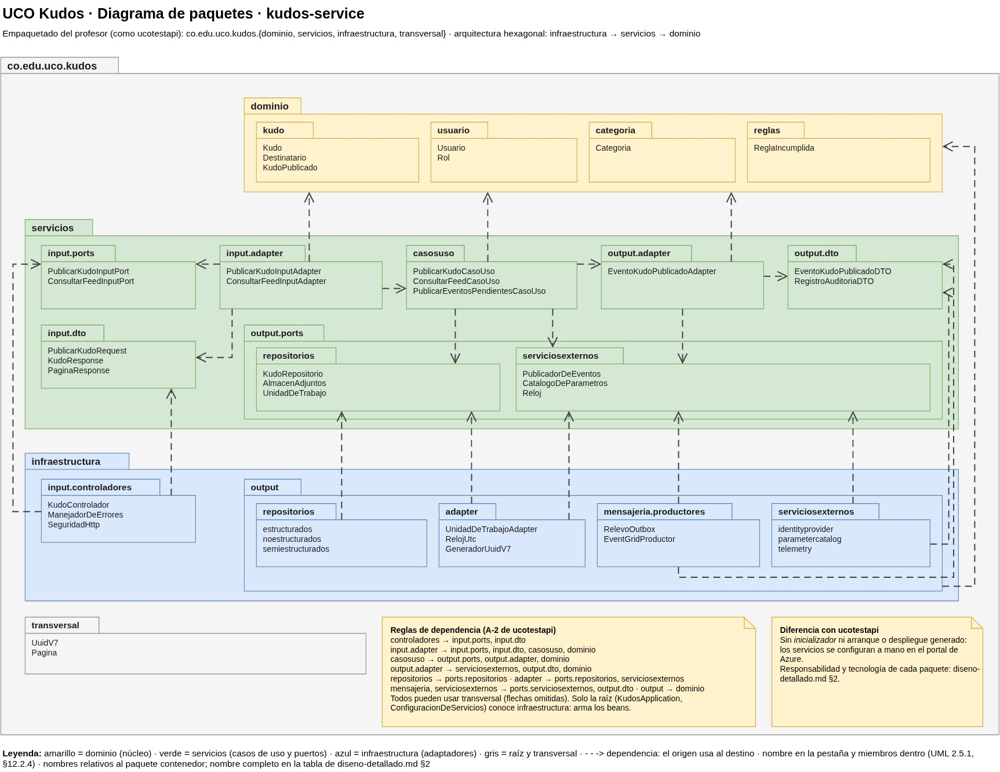

# Práctica final UCO Kudos IS2
## **Estudiante:** Juan Pablo Avendaño Duque

Este Documento aborda el desarrollo de UCO Kudos cómo práctica final para la asignatura de Ingeniería de Software 2.

---
## Contenido
1. [Qué es UCO Kudos](#1--qué-es-uco-kudos)
2. [Estrategia agéntica](#2-estrategia-agentica)
3. [Arquitectura](#3--arquitectura)
   1. [Diagrama de contexto](#31--diagrama-de-contexto)
   2. [Diagrama de contenedores](#32--diagrama-de-contenedores)
   3. [Diagrama de despliegue](#33--diagrama-de-despliegue)
   4. [Bloques de arquitectura y de solución (ABB → SBB)](#34--bloques-de-arquitectura-y-de-solución-abb--sbb)
   5. [Atributos de calidad](#35--atributos-de-calidad)
   6. [Diagrama de componentes](#36--diagrama-de-componentes)
   7. [Diseño detallado](#37--diseño-detallado)

---

## 1 · Qué es UCO Kudos
Plataforma institucional para que la comunidad UCO se reconozca públicamente. La línea base demuestra el flujo
completo de **Publicar Kudo**:

- Persistencia del reconocimiento (con archivo adjunto opcional).
- Correo electrónico al destinatario.
- Mensaje de WhatsApp al destinatario.
- Notificación push en tiempo real si el destinatario está conectado.
- Registro de auditoría de cada paso.

Consideraciones: ~90 % de los usuarios desde el celular, alto volumen de lecturas, adjuntos, y tres canales de
notificación.

---

# 2 Estrategia Agentica
Se busca el uso responsable de la inteligencia artifical, por ende se mencionarán a grandes rasgos las **practicas relacionadas con el uso de inteligencia artifical**, mostrando las herramientas que fueron utilizadas a grandes rasgos para el desarrollo y estudio de este producto.

1. **Biblioteca MCP:** Herramienta de consulta RAG que cuenta con libros y repositorios de la bibliografia compartida ademmás de contenido traido con ***Web Scraping*** Además de imagenes alimentadas que también son consultadas y utilizadas para citar libros, diagramas y documentación oficial obtenida usandolos cómo parte de una respuesta agentica.
2. **SPEC-KIT + Skills:** Utilizando herramientas públicas para agentes se añadieron herramientas de desarrollo que definen al agente un camino común de desarrollo para preguntar y definir un comportamiento robusto o profesional, además el uso con skills propias permitió el comportamiento de estudio deseado del agente garantizando preguntas, explicación y entendimiento del código antes de terminar un desarrollo.
3. **Separación de entornos:** Se implementaron ***Guardrails*** al agente de trabajo para que este sólo pueda trabajar sobre una copia local que nunca toca el repositorio, permitiendo la lectura y el review pero no una modificación directa sobre el código.
4. **Expertos de un solo tema.** Subagentes especializados, uno por práctica evaluada (Twelve-Factor, DevSecOps,
   OWASP, C4, etc) y por tecnología, que revisan solo su tema y citan la fuente.
5. **Pruebas adversarias.** Las pruebas generadas con IA dejan huecos; se complementan con agentes atacantes que
   buscan fallos que las pruebas no detectan, dando un rol de uso diferente por agente con tal de buscar el funcionamiento no esperado.
6. **Validación humana.** Cada decisión queda registrada como ADR con su autor; lo generado por IA se marca como
   borrador hasta que el estudiante lo revisa, cumpliendo así la practica **human in the loop**.
7. **Verificación de diagramas.** Los diagramas C4 los revisan los expertos de C4 y de Azure, y Archify valida el
   modelo. La disposición final de las cajas la hace el estudiante a mano en draw.io.
   ---

## 3 · Arquitectura
La arquitectura es la práctica completa: todo lo que sigue (diagramas, decisiones, código, pruebas y despliegue)
vive dentro de esta sección y se va agregando a medida que queda listo. Los diagramas están en un solo archivo con
cuatro páginas: [`docs/Diseño/Alto Nivel/c4-uco-kudos.drawio`](../docs/Dise%C3%B1o/Alto%20Nivel/c4-uco-kudos.drawio).

Mientras se dibujaban los diagramas se fue definiendo cómo se comporta el sistema; esas decisiones quedan como
citas cortas debajo de cada uno.

### 3.1 · Diagrama de contexto
**Estado:** aceptado (v5, 8-nov-2026).

UCO Kudos es un solo sistema para el miembro de la comunidad: publica, lee y recibe Kudos desde el celular. Por
fuera solo quedan dos sistemas: Microsoft Entra External ID, que autentica, y Twilio, que entrega el WhatsApp. El
correo y el push van por dentro porque son servicios de Azure que solo se configuran.

> «El administrador no es otro actor: es un miembro de la comunidad con un rol más, que además puede ver la
> auditoría.»

> «El tenant de la UCO no nos deja registrar la aplicación, entonces usamos un tenant propio de Entra External ID.»

> «Construimos lo mínimo: el front y kudos-service. Todo lo demás se configura, no se programa.» (ADR-007)

La nota amarilla del diagrama guarda tres preguntas que siguen abiertas: si el reconocimiento es entre cualquier
par de miembros, qué pasa con un Kudo a alguien que nunca ha entrado y la creación del tenant.

### 3.2 · Diagrama de contenedores
**Estado:** aceptado (v13, 9-nov-2026).

El diagrama sigue el flujo de Publicar Kudo con números del 1 al 10. El front entra por el WAF y el API Gateway,
kudos-service guarda el Kudo con su outbox y el adjunto, publica `KudoPublicado` en el Message Broker y este lo
empuja al Notification Gateway, que avisa por correo, WhatsApp y push al mismo tiempo y deja cada paso en la
auditoría. El título de cada caja es el concepto; debajo, entre corchetes, la tecnología que lo resuelve.

> «Publicar no espera a las notificaciones: el Kudo se guarda, se responde y lo demás pasa por detrás.»

> «El evento se empuja, no se pregunta por él: por eso Event Grid y no una cola.» (ADR-007)

> «Si el mismo evento llega dos veces, nadie recibe dos correos.» (ADR-009)

> «Una sola puerta de entrada: todo pasa por el WAF, y aun así kudos-service revisa el token.» (ADR-006, ADR-013)

### 3.3 · Diagrama de despliegue
**Estado:** aceptado (v4, 9-nov-2026).

Muestra dónde corre cada contenedor del diagrama anterior: todo en una suscripción de Azure for Students, en la
región `brazilsouth`, más GitHub para el CI/CD. Se ven los planes elegidos, el service mesh mínimo de Container
Apps y los riesgos que se aceptan por costo.

> «No hay red privada porque no cabe en el crédito; cada capa revisa el token y lo que no cubre queda escrito.»
> (ADR-013)

> «Un pull request nunca despliega: solo `main`, después de Sonar y Trivy y con mi aprobación.» (ADR-014)

> «Con un solo servicio propio, la malla es la que trae la plataforma.» (ADR-008)

### 3.4 · Bloques de arquitectura y de solución (ABB → SBB)
**Estado:** borrador revisado (9-nov-2026).

El ABB es la capacidad que el sistema necesita, sin marca; el SBB es el producto que la resuelve. Tipo: **P** propio
(código), **A** administrado de Azure (configuración), **E** externo.

> «El concepto se queda; el producto puede cambiar. Cambiar el producto es una ADR nueva, no otra arquitectura.»

| # | ABB | SBB | Tipo | ADR |
|---|---|---|---|---|
| 1 | Front web | SPA Vue 3 + TypeScript en Blob `$web` | P | 002 |
| 2 | Servicio de Kudos | Java 21 + Spring Boot en Container Apps | P | 007, 013 |
| 3 | Publicación fiable de eventos (outbox) | Outbox en PostgreSQL + relevo `@Scheduled` | P | 010 |
| 4 | Identity Provider | Microsoft Entra External ID | E | 013 |
| 5 | WAF | Azure Front Door Standard + política WAF | A | 006, 013 |
| 6 | CDN | Azure Front Door | A | 006 |
| 7 | API Gateway | Azure API Management Consumption | A | 006, 013 |
| 8 | Message Broker | Azure Event Grid + dead-letter en Blob | A | 007 |
| 9 | Notification Gateway | Azure Logic Apps Consumption | A | 007, 009 |
| 10 | Servicio de correo | Azure Communication Services Email | A | 006 |
| 11 | Mensajería WhatsApp | Twilio WhatsApp API | E | 006 |
| 12 | Real-time Push | Azure Web PubSub Free | A | 016 |
| 13 | Base de datos | Azure Database for PostgreSQL Flexible | A | 010, 013 |
| 14 | Caché | Azure Managed Redis | A | 011, 017 |
| 15 | Almacén de adjuntos | Azure Blob Storage + SAS de delegación | A | 013 |
| 16 | Registro de auditoría | Azure Table Storage | A | 012 |
| 17 | Data Mesh | Azure Data Factory + Blob con catálogo | A | 015 |
| 18 | Service Mesh | Entorno de Container Apps (Envoy + mTLS) | A | 008 |
| 19 | Gestor de secretos | Azure Key Vault | A | 003, 013 |
| 20 | Parameter Catalog | Azure App Configuration | A | 003 |
| 21 | Observabilidad | Application Insights + Log Analytics | A | — |
| 22 | Pipeline CI/CD | GitHub Actions + OIDC | E | 014 |
| 23 | Análisis estático | SonarQube Cloud | E | 014 |
| 24 | Escáner de vulnerabilidades | Trivy | E | 014 |
| 25 | Registro de imágenes | GitHub Container Registry | E | 014 |
| 26 | Ejecución de contenedores | Azure Container Apps | A | 008, 014 |

### 3.5 · Atributos de calidad
**Estado:** aceptado (9-nov-2026).

Los atributos salen de los drivers del enunciado (DRV-001 a DRV-007) y se escriben como escenarios de seis partes:
fuente, estímulo, entorno, artefacto, respuesta y medida de la respuesta, con los nombres de *Software Architecture in
Practice* (Bass, Clements y Kazman, 3.ª ed.). Cada escenario nombra componentes del diagrama, no productos, y su medida
se puede probar. El detalle completo está en el diseño de alto nivel.

> «Si no se puede medir, no es un atributo de calidad, es un deseo.»

> «El costo no es un atributo: es una restricción que manda sobre todo lo demás.»

| # | Atributo | Escenario | Medida de la respuesta |
|---|---|---|---|
| QA-1 | Rendimiento | 100 miembros consultan el feed en carga pico | p95 < 300 ms; aciertos de la Caché ≥ 80 % |
| QA-2 | Rendimiento | Un miembro publica un Kudo, incluso con un canal caído | p95 < 500 ms |
| QA-3 | Disponibilidad | Mensajería WhatsApp no responde durante una publicación | 0 Kudos perdidos; 0 avisos duplicados; reintento < 1 min |
| QA-4 | Seguridad | Un rol sin permiso intenta administrar categorías, vetar o tocar datos ajenos | 100 % de intentos resistidos en la matriz endpoint × 7 roles |
| QA-5 | Modificabilidad | Se pide un canal nuevo o cambiar un proveedor | 0 líneas cambiadas en el Servicio de Kudos |
| QA-6 | Usabilidad (movilidad) | Un miembro abre la app desde un celular con 4G | LCP < 2,5 s; sin scroll horizontal a 360 px |
| QA-7 | Seguridad (no repudio) | Se publica un Kudo | 100 % de los pasos en Auditoría; nadie puede borrar el registro |
| QA-9 | Rendimiento | Llega un Kudo para un destinatario conectado | Aviso en tiempo real p95 < 10 s |
| QA-10 | Seguridad | Se sube un archivo falso o se pide un adjunto ajeno | 100 % rechazados (4xx / 403) |
| QA-11 | Desplegabilidad | Se integra un cambio a `main` | Despliegue < 15 min; vuelta atrás < 5 min; vulnerabilidades HIGH bloquean |
| QA-12 | Seguridad | Un Kudo trae inyección SQL o `<script>` | 100 % de cargas sin ejecutarse |
| QA-13 | Escalabilidad | Pico de 10× la carga de lectura durante 5 min | 1 → 3 réplicas en < 2 min; 0 errores 5xx |
| QA-14 | Disponibilidad | Se borra un adjunto o se daña la Base de datos | RPO ≤ 5 min; RTO medido, meta < 2 h |
| QA-15 | Monitoreabilidad | Falla un canal o se acumulan eventos fallidos | Alerta < 5 min; traza completa por `correlationId` |
| QA-16 | Capacidad de ser teasteado | Se termina un caso de uso del núcleo | Cobertura ≥ 80 % del dominio; mutación reportada |
| QA-17 | Interoperabilidad | Se publica el evento `KudoPublicado` con esquema versionado | 100 % de pruebas de contrato en verde |

### 3.6 · Diagrama de componentes

Es el zoom al Servicio de Kudos. Cada caja es un componente por funcionalidad: agrupa todo lo de su función detrás de una interfaz y por dentro es hexagonal (dominio, casos de uso y adaptadores). Para la línea base son seis: Usuarios y acceso, Reconocimientos, Adjuntos, Categorías, Eventos de integración y Auditoría. Moderación y Calificaciones llegan después.

>«Un componente es un grupo de funcionalidad relacionada detrás de una interfaz bien definida; no una clase.» (Simon Brown, The C4 model; Clean Architecture, cap. 34)

>«Reconocimientos es el centro: todo lo demás le presta un servicio.»

### 3.7 · Diseño detallado
Fuentes en [`docs/Diseño/Detallado/Diagramas/`](../docs/Dise%C3%B1o/Detallado/Diagramas/).

#### Paquetes

El código del Servicio de Kudos se organiza con el empaquetado del profesor, el mismo de la práctica `ucotestapi`, en
tres capas. Abajo está **infraestructura**, con los controladores REST y los adaptadores a PostgreSQL, Azure y Event
Grid. En medio están los **servicios**, con los casos de uso y sus puertos de entrada y salida. Arriba está el
**dominio**, Java puro. Cada flecha es una dependencia y todas apuntan hacia el dominio: cada paquete de
infraestructura implementa el puerto que tiene justo encima.

#### Modelo de dominio

Las clases del dominio agrupadas por componente. Hay tres agregados: Kudo (con sus adjuntos), Usuario y Categoría. Entre ellos solo se conocen por id, así cada componente cambia sin arrastrar a los demás. Cuando se publica un Kudo nace el evento KudoPublicado, que lleva los datos del destinatario para avisarle. Todo es Java puro, sin Spring.

>«Kudo no conoce a Usuario, conoce su id: cada agregado cuida su propia consistencia.»

>«Usuario se crea con los datos del token la primera vez que entra; así, cuando alguien le manda un Kudo, ya sabemos a dónde avisarle.»

#### Entidad-relación · Base de datos

Cinco tablas en la Base de datos: usuario, categoria, kudo, adjunto y outbox_evento. El outbox guarda el evento en la misma transacción que el Kudo y no tiene llaves foráneas, para que el relevo lo lea sin tocar lo demás. La auditoría no vive aquí, va al Registro de auditoría. Las tablas e índices se crean con Flyway.

>«El feed se pagina por fecha e id; el índice va en ese mismo orden para no saltar ni repetir Kudos.»

#### Secuencia · Publicar Kudo

Se lee en cuatro tramos: la petición entra y se valida; el Kudo y su evento se guardan en una sola transacción; se audita, se limpia la caché del feed y se responde 201; y por detrás el relevo publica el evento y el Notification Gateway avisa por correo, WhatsApp y push al mismo tiempo.

>«El 201 sale antes de las notificaciones: publicar no espera a nadie.» (ADR-007)

>«El Kudo y su evento viajan juntos o no viaja ninguno.» (ADR-010)